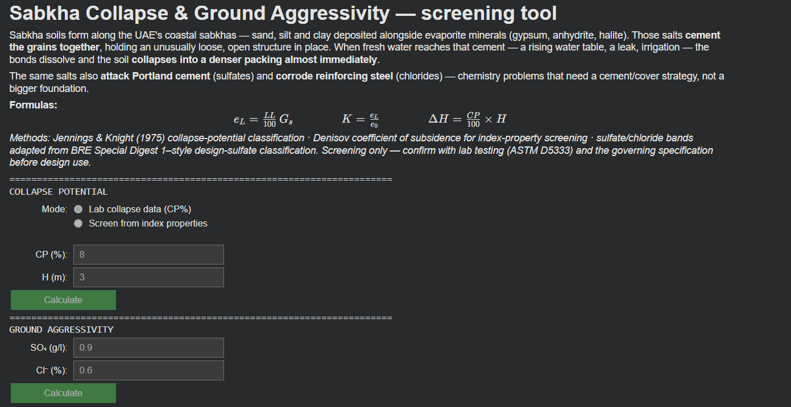

# Sabkha Collapse & Ground Aggressivity Screening Tool

An interactive Python notebook for the preliminary screening of collapse potential and ground aggressivity in sabkha soils (typical of UAE coastal regions). 

Sabkha soils contain evaporite minerals (gypsum, halite) that cement the grains together in a loose structure. When exposed to fresh water, these bonds dissolve, leading to rapid soil collapse. The same salts also chemically attack concrete and reinforcing steel. This tool helps screen these risks using index properties or lab data.

**Disclaimer:** This tool is for preliminary screening only. It is not a substitute for detailed geotechnical investigation. Always confirm results with laboratory testing (ASTM D5333) and the governing project specification.

## Methods & Classification

### 1. Collapse Potential
*   **Mode A (Lab Data):** Uses the Jennings & Knight (1975) classification based on measured Collapse Potential (CP%) from oedometer tests. Calculates estimated settlement: `ΔH = (CP / 100) × H`.
*   **Mode B (Index Screening):** Uses the Denisov coefficient (`K = e_L / e_0`, where `e_L = (LL / 100) × Gs`) to estimate collapsibility when lab data is unavailable.

### 2. Ground Aggressivity
*   **Sulfate (SO₄):** Classifies soil based on design sulfate class (DS-1 to DS-5), adapted from BRE Special Digest 1, and provides cement/cover recommendations.
*   **Chloride (Cl⁻):** Classifies corrosion risk to reinforcing steel based on percentage by dry soil mass.

## Gallery

## Usage

**Option 1: Run in Browser (No installation)**
Click the "Open in Colab" badge at the top of this file. Once loaded, go to `Runtime > Run all` in the top menu.

**Option 2: Run Locally**

    git clone https://github.com/NarasimhaThota9/sabkha-deposits.git
    cd sabkha-deposits
    pip install ipywidgets plotly
    jupyter notebook

## Limitations
*   Index-property screening is a correlation and should not replace direct testing.
*   Class boundaries are adapted from published guidance; site-specific specifications take precedence.
*   The tool evaluates single-point inputs. It does not account for stratigraphy, loading conditions, or inundation extent.

## References
*   Jennings, J.E. & Knight, K. (1975). *A guide to construction on or with materials exhibiting additional settlement due to collapse of grain structure.*
*   Denisov, N.Y. (1961). *Engineering properties of loess and loess-like soils.*
*   ASTM D5333 - Standard Test Method for Measurement of Collapse Potential of Soils.
*   BRE Special Digest 1 - Concrete in aggressive ground.

## Author
Narasimha Thota
